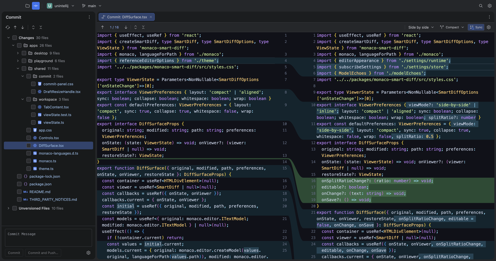
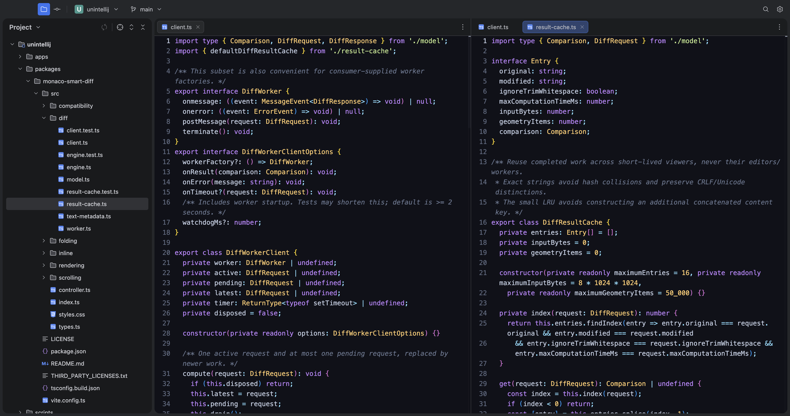

# unintellij

unintelligent development environment

## why i made it

i've been using IntelliJ IDEA for the last 10 years. for the last few years, my workflow has mostly centered around ai agents, and i mainly use the editor to review files and changes in a diff viewer

i made this because of performance and stability issues with recent versions of intellij – crashes, high memory usage and general slowness

the main thing keeping me on intellij was its diff viewer. i couldn't recreate it with monaco before, but in this repo i've tried to get as close as possible

## main ideas

- no intelligence – just a plain editor built on monaco with syntax highlighting
- no ai, smart code analysis or indexing
- only things i actually need from an editor

## code

this is an electron desktop app written in typescript. you can run it from source, fork it or use parts of it in your own project

## future plans

i built this in 2 days, so maybe i'll keep maintaining it and add things i need for my own workflow
